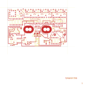

# 14-060 - AP94005

Converted to KiCad from `WBSps Engineering from H drive/Wbsps - MASTERS/AP94005/14-060.PCB` (tango).

| Components | Pads | Track segments | Vias | Pours |
|---|---|---|---|---|
| 97 | 249 | 480 | 3 | 15 |

Nets: none (no matching netlist).

Other copies of the same file:

- `WBSps Engineering from H drive-20261018T013433Z-1-001/WBSps Engineering from H drive/Wbsps - MASTERS/AP94005/14-060.PCB`
