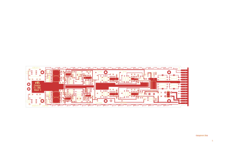

# 14-265 - AP93001

Converted to KiCad from `WBSps Engineering from H drive/Wbsps - MASTERS/AP93001/14-265.PCB` (tango).

| Components | Pads | Track segments | Vias | Pours |
|---|---|---|---|---|
| 153 | 403 | 1101 | 78 | 35 |

Nets: none (no matching netlist).

Other copies of the same file:

- `WBSps Engineering from H drive-20261018T013433Z-1-002/WBSps Engineering from H drive/Wbsps - MASTERS/AP93001/14-265.PCB`
