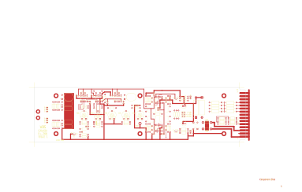

# 14-266 - AP93001

Converted to KiCad from `WBSps Engineering from H drive/Wbsps - MASTERS/AP93001/14-266.PCB` (tango).

| Components | Pads | Track segments | Vias | Pours |
|---|---|---|---|---|
| 122 | 321 | 562 | 4 | 5 |

Nets: none (no matching netlist).

Other copies of the same file:

- `WBSps Engineering from H drive-20261018T013433Z-1-001/WBSps Engineering from H drive/Wbsps - MASTERS/AP93001/14-266.PCB`
