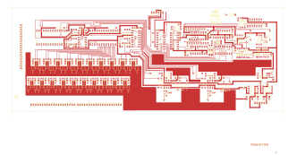

# 14-273 - SA14-273 10X1 STEREO SELECTOR ASSEMBLY

**SA14-273 10X1 STEREO SELECTOR ASSEMBLY**

Converted to KiCad from `WBSps Engineering from H drive/WBSps - SA14-XXX/SA14-273/14-273.PCB` (tango).

| Components | Pads | Track segments | Vias | Pours |
|---|---|---|---|---|
| 273 | 800 | 2638 | 39 | 51 |

Nets: none (no matching netlist).

Other copies of the same file:

- `WBSps Engineering from H drive-20261018T013433Z-1-001/WBSps Engineering from H drive/WBSps - SA14-XXX/SA14-273/14-273.PCB`
