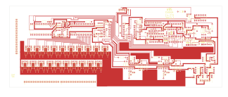

# 14-273A - AP93001

Converted to KiCad from `WBSps Engineering from H drive/Wbsps - MASTERS/AP93001/14-273A.PCB` (tango).

| Components | Pads | Track segments | Vias | Pours |
|---|---|---|---|---|
| 270 | 796 | 2620 | 38 | 50 |

Nets: none (no matching netlist).

Other copies of the same file:

- `WBSps Engineering from H drive-20261018T013433Z-1-002/WBSps Engineering from H drive/Wbsps - MASTERS/AP93001/14-273A.PCB`
