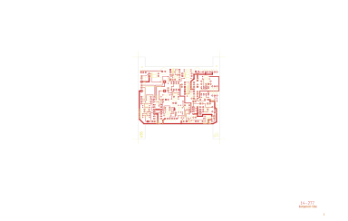

# 14-277 - SA14-277

Converted to KiCad from `WBSps Engineering from H drive/WBSps - SA14-XXX/SA14-277/14-277.PCB` (tango).

| Components | Pads | Track segments | Vias | Pours |
|---|---|---|---|---|
| 110 | 284 | 567 | 4 | 13 |

Nets: none (no matching netlist).

Other copies of the same file:

- `WBSps Engineering from H drive-20261018T013433Z-1-001/WBSps Engineering from H drive/WBSps - SA14-XXX/SA14-277/14-277.PCB`
