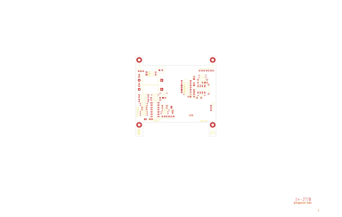

# 14-277B - SA14-277

Converted to KiCad from `WBSps Engineering from H drive/WBSps - SA14-XXX/SA14-277/14-277B.PCB` (tango).

| Components | Pads | Track segments | Vias | Pours |
|---|---|---|---|---|
| 60 | 170 | 6 | 0 | 8 |

Nets: none (no matching netlist).

Other copies of the same file:

- `WBSps Engineering from H drive-20261018T013433Z-1-002/WBSps Engineering from H drive/WBSps - SA14-XXX/SA14-277/14-277B.PCB`
