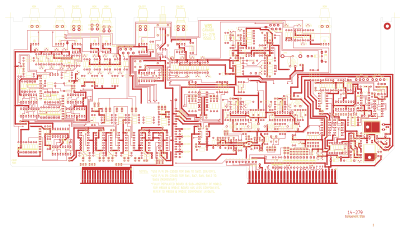

# 14-279 - SA14-279

Converted to KiCad from `WBSps Engineering from H drive/WBSps - SA14-XXX/SA14-279/14-279.PCB` (tango).

| Components | Pads | Track segments | Vias | Pours |
|---|---|---|---|---|
| 590 | 1785 | 4309 | 96 | 107 |

Nets: none (no matching netlist).

Other copies of the same file:

- `WBSps Engineering from H drive-20261018T013433Z-1-002/WBSps Engineering from H drive/WBSps - SA14-XXX/SA14-279/14-279.PCB`
