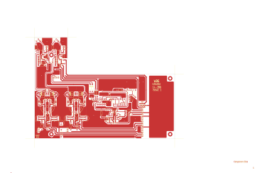

# 14-280 - SA14-280 INPUT AMPLIFIER ASSEMBLY

**SA14-280 INPUT AMPLIFIER ASSEMBLY**

Converted to KiCad from `WBSps Engineering from H drive/WBSps - SA14-XXX/SA14-280/14-280.PCB` (tango).

| Components | Pads | Track segments | Vias | Pours |
|---|---|---|---|---|
| 103 | 277 | 1870 | 28 | 71 |

Nets: none (no matching netlist).

Other copies of the same file:

- `WBSps Engineering from H drive-20261018T013433Z-1-002/WBSps Engineering from H drive/WBSps - SA14-XXX/SA14-280/14-280.PCB`
