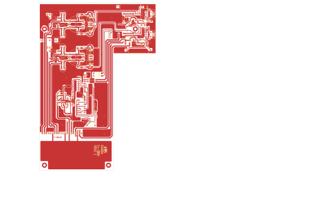

# 14-280A - SA14-280

Converted to KiCad from `WBSps Engineering from H drive/WBSps - SA14-XXX/SA14-280/14-280A.PCB` (tango).

| Components | Pads | Track segments | Vias | Pours |
|---|---|---|---|---|
| 107 | 297 | 1874 | 26 | 87 |

Nets: none (no matching netlist).

Other copies of the same file:

- `WBSps Engineering from H drive-20261018T013433Z-1-001/WBSps Engineering from H drive/WBSps - SA14-XXX/SA14-280/14-280A.PCB`
