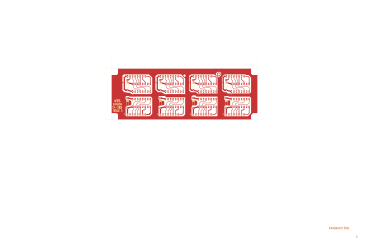

# 14-283 - AP93001

Converted to KiCad from `WBSps Engineering from H drive/Wbsps - MASTERS/AP93001/14-283.PCB` (tango).

| Components | Pads | Track segments | Vias | Pours |
|---|---|---|---|---|
| 39 | 230 | 663 | 0 | 23 |

Nets: none (no matching netlist).

Other copies of the same file:

- `WBSps Engineering from H drive-20261018T013433Z-1-001/WBSps Engineering from H drive/Wbsps - MASTERS/AP93001/14-283.PCB`
