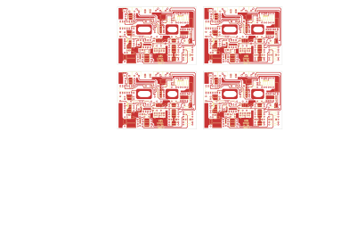

# 14-284 - SA14-284

Converted to KiCad from `WBSps Engineering from H drive/WBSps - SA14-XXX/SA14-284/14-284.PCB` (tango).

| Components | Pads | Track segments | Vias | Pours |
|---|---|---|---|---|
| 329 | 888 | 2176 | 24 | 188 |

Nets: none (no matching netlist).

Other copies of the same file:

- `WBSps Engineering from H drive-20261018T013433Z-1-002/WBSps Engineering from H drive/WBSps - SA14-XXX/SA14-284/14-284.PCB`
