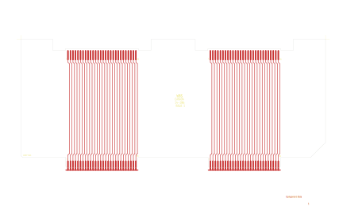

# 14-285 - SA14-285

Converted to KiCad from `WBSps Engineering from H drive/WBSps - SA14-XXX/SA14-285/14-285.PCB` (tango).

| Components | Pads | Track segments | Vias | Pours |
|---|---|---|---|---|
| 9 | 228 | 342 | 0 | 4 |

Nets: none (no matching netlist).

Other copies of the same file:

- `WBSps Engineering from H drive-20261018T013433Z-1-002/WBSps Engineering from H drive/WBSps - SA14-XXX/SA14-285/14-285.PCB`
