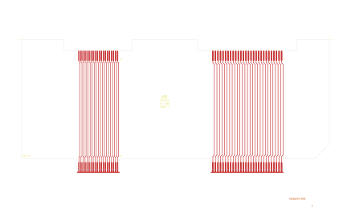

# 14-286 - SA14-286

Converted to KiCad from `WBSps Engineering from H drive/WBSps - SA14-XXX/SA14-286/14-286.PCB` (tango).

| Components | Pads | Track segments | Vias | Pours |
|---|---|---|---|---|
| 9 | 196 | 293 | 0 | 4 |

Nets: none (no matching netlist).

Other copies of the same file:

- `WBSps Engineering from H drive-20261018T013433Z-1-001/WBSps Engineering from H drive/WBSps - SA14-XXX/SA14-286/14-286.PCB`
