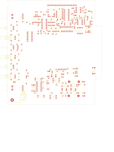

# 14-290A - AP94005

Converted to KiCad from `WBSps Engineering from H drive/Wbsps - MASTERS/AP94005/14-290A.PCB` (tango).

| Components | Pads | Track segments | Vias | Pours |
|---|---|---|---|---|
| 167 | 471 | 1 | 0 | 9 |

Nets: none (no matching netlist).

Other copies of the same file:

- `WBSps Engineering from H drive-20261018T013433Z-1-001/WBSps Engineering from H drive/Wbsps - MASTERS/AP94005/14-290A.PCB`
