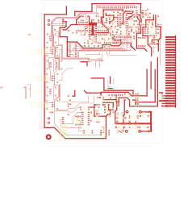

# 14-290A

Converted to KiCad from `WBSps Engineering from H drive/WBSps - CONSOLES/REN TV Console/M922/OLD/14-290A.PCB` (tango).

| Components | Pads | Track segments | Vias | Pours |
|---|---|---|---|---|
| 168 | 527 | 1380 | 7 | 10 |

Nets: none (no matching netlist).

Other copies of the same file:

- `wbsPS-NOT UPLOADED/XXX - REN TV Console-20221115T024141Z-001/REN TV Console/M922/OLD/14-290A.PCB`
- `WBSps Engineering from H drive-20261018T013433Z-1-003/WBSps Engineering from H drive/WBSps - CONSOLES/REN TV Console/M922/OLD/14-290A.PCB`
