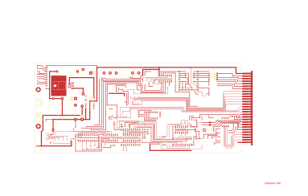

# 14-291A - M718A

Converted to KiCad from `WBSps Engineering from H drive/WBSps - M7XX/M718/M718A/14-291A.PCB` (tango).

| Components | Pads | Track segments | Vias | Pours |
|---|---|---|---|---|
| 62 | 346 | 1286 | 37 | 11 |

Nets: none (no matching netlist).

Other copies of the same file:

- `WBSps Engineering from H drive-20261018T013433Z-1-003/WBSps Engineering from H drive/WBSps - M7XX/M718/M718A/14-291A.PCB`
