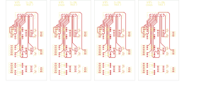

# 14-295 - SA14-295

Converted to KiCad from `WBSps Engineering from H drive/WBSps - SA14-XXX/SA14-295/14-295.PCB` (tango).

| Components | Pads | Track segments | Vias | Pours |
|---|---|---|---|---|
| 192 | 540 | 1172 | 0 | 24 |

Nets: none (no matching netlist).

Other copies of the same file:

- `WBSps Engineering from H drive-20261018T013433Z-1-002/WBSps Engineering from H drive/WBSps - SA14-XXX/SA14-295/14-295.PCB`
