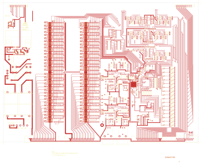

# 14-300 - SA14-300 CONTROL ASSEMBLY

**SA14-300 CONTROL ASSEMBLY**

Converted to KiCad from `WBSps Engineering from H drive/WBSps - RS8216 Remote Switcher/SA14-300/14-300.PCB` (tango).

| Components | Pads | Track segments | Vias | Pours |
|---|---|---|---|---|
| 571 | 2033 | 4391 | 243 | 7 |

Nets: none (no matching netlist).

Other copies of the same file:

- `WBSps Engineering from H drive-20261018T013433Z-1-001/WBSps Engineering from H drive/WBSps - RS8216 Remote Switcher/SA14-300/14-300.PCB`
