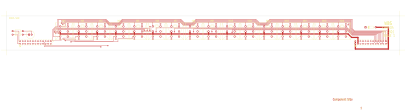

# 14-301 - SA14-301

Converted to KiCad from `WBSps Engineering from H drive/WBSps - RS8216 Remote Switcher/SA14-301/14-301.PCB` (tango).

| Components | Pads | Track segments | Vias | Pours |
|---|---|---|---|---|
| 33 | 198 | 501 | 22 | 1 |

Nets: none (no matching netlist).

Other copies of the same file:

- `WBSps Engineering from H drive-20261018T013433Z-1-002/WBSps Engineering from H drive/WBSps - RS8216 Remote Switcher/SA14-301/14-301.PCB`
