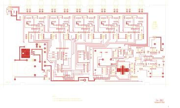

# 14-302 - IKR-10A INTERCOM KEY CONTROL & AUDIO FUNCTIONAL

**IKR-10A INTERCOM KEY CONTROL & AUDIO FUNCTIONAL**

Converted to KiCad from `WBSps Engineering from H drive/WBSps - IKR/IKR10/14-302.PCB` (tango).

| Components | Pads | Track segments | Vias | Pours |
|---|---|---|---|---|
| 257 | 769 | 1515 | 85 | 61 |

Nets: none (no matching netlist).

Other copies of the same file:

- `wbsPS-NOT UPLOADED/WBSps - IKR-20221115T024105Z-001/WBSps - IKR/IKR10/14-302.PCB`
- `WBSps Engineering from H drive-20261018T013433Z-1-002/WBSps Engineering from H drive/WBSps - IKR/IKR10/14-302.PCB`
