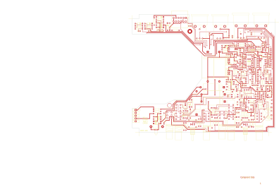

# 14-306 - POD4 DUAL MICROPHONE PRAMPLIFIER

**POD4 DUAL MICROPHONE PRAMPLIFIER**

Converted to KiCad from `WBSps Engineering from H drive/WBSps - POD_OLD/POD4/14-306.PCB` (tango).

| Components | Pads | Track segments | Vias | Pours |
|---|---|---|---|---|
| 201 | 556 | 1402 | 44 | 21 |

Nets: none (no matching netlist).

Other copies of the same file:

- `wbsPS-NOT UPLOADED/WBSps - POD_OLD-20221115T024220Z-001/WBSps - POD_OLD/POD4/14-306.PCB`
- `WBSps Engineering from H drive-20261018T013433Z-1-002/WBSps Engineering from H drive/WBSps - POD_OLD/POD4/14-306.PCB`
