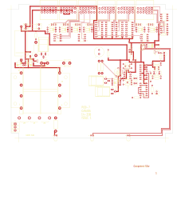

# 14-316 - POD 7 - CONTROL ROOM INTERFACE

**POD 7 - CONTROL ROOM INTERFACE**

Converted to KiCad from `WBSps Engineering from H drive/WBSps - POD_OLD/POD7/ISS1/TANGO/14-316.PCB` (tango).

| Components | Pads | Track segments | Vias | Pours |
|---|---|---|---|---|
| 119 | 444 | 866 | 0 | 15 |

Nets: from `WBSps Engineering from H drive/WBSps - POD_OLD/POD7/ISS1/ORCAD/POD7.NET`.

Other copies of the same file:

- `wbsPS-NOT UPLOADED/WBSps - POD_OLD-20221115T024220Z-001/WBSps - POD_OLD/POD7/ISS1/TANGO/14-316.PCB`
- `WBSps Engineering from H drive-20261018T013433Z-1-002/WBSps Engineering from H drive/WBSps - POD_OLD/POD7/ISS1/TANGO/14-316.PCB`
