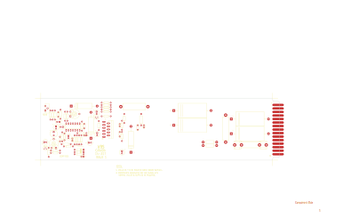

# 14-317 - 10 WATT POWER AMPLIFIER

**10 WATT POWER AMPLIFIER**

Converted to KiCad from `WBSps Engineering from H drive/WBSps - M7XX/M719/TANGO/14-317.PCB` (tango).

| Components | Pads | Track segments | Vias | Pours |
|---|---|---|---|---|
| 82 | 212 | 357 | 0 | 3 |

Nets: from `WBSps Engineering from H drive/WBSps - M7XX/M719/ORCAD/M719.NET`.

Other copies of the same file:

- `WBSps Engineering from H drive-20261018T013433Z-1-002/WBSps Engineering from H drive/WBSps - M7XX/M719/TANGO/14-317.PCB`
