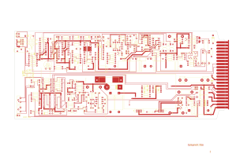

# 14-318

Converted to KiCad from `WBSps Engineering from H drive/WBSps - M7XX/M703D/TANGO/14-318.PCB` (tango).

| Components | Pads | Track segments | Vias | Pours |
|---|---|---|---|---|
| 276 | 705 | 1384 | 7 | 33 |

Nets: none (no matching netlist).

Other copies of the same file:

- `WBSps Engineering from H drive-20261018T013433Z-1-002/WBSps Engineering from H drive/WBSps - M7XX/M703D/TANGO/14-318.PCB`
