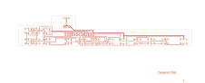

# 14-320

Converted to KiCad from `WBSps Engineering from H drive/WBSps - SA14-XXX/SA14-320/TANGO/14-320.PCB` (tango).

| Components | Pads | Track segments | Vias | Pours |
|---|---|---|---|---|
| 39 | 127 | 268 | 0 | 16 |

Nets: none (no matching netlist).

Other copies of the same file:

- `WBSps Engineering from H drive-20261018T013433Z-1-003/WBSps Engineering from H drive/WBSps - SA14-XXX/SA14-320/TANGO/14-320.PCB`
