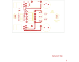

# 14-321A - SA14-321A BIPOLAR DC TO DC CONVERTOR

**SA14-321A BIPOLAR DC TO DC CONVERTOR**

Converted to KiCad from `WBSps Engineering from H drive/WBSps - SA14-XXX/SA14-321/TANGO/14-321A.PCB` (tango).

| Components | Pads | Track segments | Vias | Pours |
|---|---|---|---|---|
| 36 | 78 | 191 | 0 | 10 |

Nets: from `WBSps Engineering from H drive/WBSps - SA14-XXX/SA14-321/ORCADWIN/SA14321A.NET`.

Other copies of the same file:

- `WBSps Engineering from H drive-20261018T013433Z-1-003/WBSps Engineering from H drive/WBSps - SA14-XXX/SA14-321/TANGO/14-321A.PCB`
