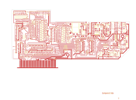

# 14-323

Converted to KiCad from `WBSps Engineering from H drive/WBSps - CONSOLES/REN TV Console/M926/OLD/14-323.PCB` (tango).

| Components | Pads | Track segments | Vias | Pours |
|---|---|---|---|---|
| 191 | 740 | 2946 | 118 | 17 |

Nets: from `WBSps Engineering from H drive/WBSps - CONSOLES/REN TV Console/M926/OLD/14-323_1.NET`.

Other copies of the same file:

- `wbsPS-NOT UPLOADED/XXX - REN TV Console-20221115T024141Z-001/REN TV Console/M926/OLD/14-323.PCB`
- `WBSps Engineering from H drive-20261018T013433Z-1-003/WBSps Engineering from H drive/WBSps - CONSOLES/REN TV Console/M926/OLD/14-323.PCB`
