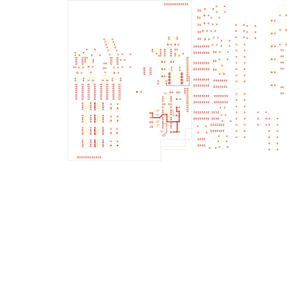

# 14-326 - SA14-326 STEREO LINE PREAMPLIFIER+

**SA14-326 STEREO LINE PREAMPLIFIER**

Converted to KiCad from `WBSps Engineering from H drive/WBSps - SA14-XXX/SA14-325/TANGO/14-326.PCB` (tango).

| Components | Pads | Track segments | Vias | Pours |
|---|---|---|---|---|
| 229 | 748 | 193 | 0 | 16 |

Nets: none (no matching netlist).

Other copies of the same file:

- `WBSps Engineering from H drive-20261018T013433Z-1-001/WBSps Engineering from H drive/WBSps - SA14-XXX/SA14-325/TANGO/14-326.PCB`
