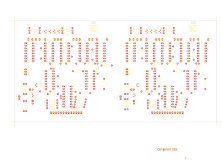

# 14-329

Converted to KiCad from `WBSps Engineering from H drive/WBSps - SA14-XXX/SA14-329/TANGO/14-329.PCB` (tango).

| Components | Pads | Track segments | Vias | Pours |
|---|---|---|---|---|
| 146 | 516 | 872 | 0 | 0 |

Nets: none (no matching netlist).

Other copies of the same file:

- `WBSps Engineering from H drive-20261018T013433Z-1-002/WBSps Engineering from H drive/WBSps - SA14-XXX/SA14-329/TANGO/14-329.PCB`
