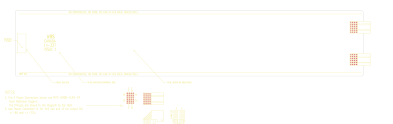

# 14-337

Converted to KiCad from `WBSps Engineering from H drive/WBSps - D2000 Digital rack/D2000/TANGO/14-337.PCB` (tango).

| Components | Pads | Track segments | Vias | Pours |
|---|---|---|---|---|
| 4 | 107 | 0 | 0 | 0 |

Nets: none (no matching netlist).

Other copies of the same file:

- `WBSps Engineering from H drive-20261018T013433Z-1-003/WBSps Engineering from H drive/WBSps - D2000 Digital rack/D2000/TANGO/14-337.PCB`
