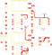

# HELP

Converted to KiCad from `WBSps Engineering from H drive/WBSps - SA14-XXX/SA14-325/TANGO/HELP.PCB` (tango).

| Components | Pads | Track segments | Vias | Pours |
|---|---|---|---|---|
| 33 | 76 | 134 | 0 | 5 |

Nets: none (no matching netlist).

Other copies of the same file:

- `WBSps Engineering from H drive-20261018T013433Z-1-001/WBSps Engineering from H drive/WBSps - SA14-XXX/SA14-325/TANGO/HELP.PCB`
