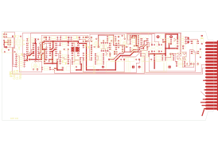

# M701D

Converted to KiCad from `WBSps Engineering from H drive/WBSps - M7XX/M703D/TANGO/M701D.PCB` (tango).

| Components | Pads | Track segments | Vias | Pours |
|---|---|---|---|---|
| 159 | 427 | 770 | 3 | 15 |

Nets: none (no matching netlist).

Other copies of the same file:

- `WBSps Engineering from H drive-20261018T013433Z-1-001/WBSps Engineering from H drive/WBSps - M7XX/M703D/TANGO/M701D.PCB`
