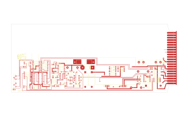

# M702D

Converted to KiCad from `WBSps Engineering from H drive/WBSps - M7XX/M703D/TANGO/M702D.PCB` (tango).

| Components | Pads | Track segments | Vias | Pours |
|---|---|---|---|---|
| 123 | 328 | 638 | 4 | 19 |

Nets: none (no matching netlist).

Other copies of the same file:

- `WBSps Engineering from H drive-20261018T013433Z-1-003/WBSps Engineering from H drive/WBSps - M7XX/M703D/TANGO/M702D.PCB`
