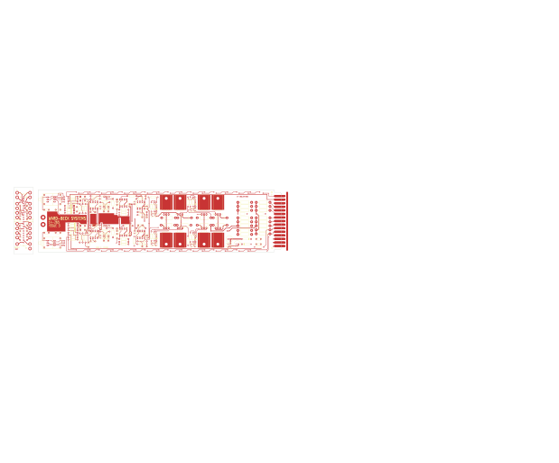

# M8205W - M8204

Converted to KiCad from `WBSps Engineering from H drive/WBSps - M82X_OLD/M8204/M8205W.PCB` (tango).

| Components | Pads | Track segments | Vias | Pours |
|---|---|---|---|---|
| 170 | 499 | 1381 | 98 | 51 |

Nets: none (no matching netlist).

Other copies of the same file:

- `WBSps Engineering from H drive-20261018T013433Z-1-002/WBSps Engineering from H drive/WBSps - M82X_OLD/M8204/M8205W.PCB`
