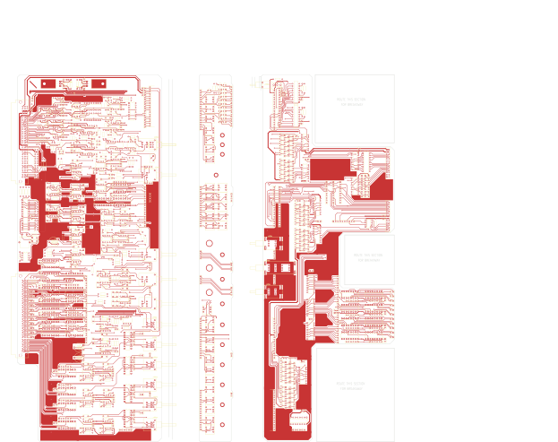

# M920WORK - M920

Converted to KiCad from `WBSps Engineering from H drive/WBSps - CONSOLES/REN TV Console/M920/M920WORK.PCB` (tango).

| Components | Pads | Track segments | Vias | Pours |
|---|---|---|---|---|
| 717 | 3603 | 7611 | 416 | 147 |

Nets: none (no matching netlist).

Other copies of the same file:

- `wbsPS-NOT UPLOADED/XXX - REN TV Console-20221115T024141Z-001/REN TV Console/M920/M920WORK.PCB`
- `WBSps Engineering from H drive-20261018T013433Z-1-002/WBSps Engineering from H drive/WBSps - CONSOLES/REN TV Console/M920/M920WORK.PCB`
