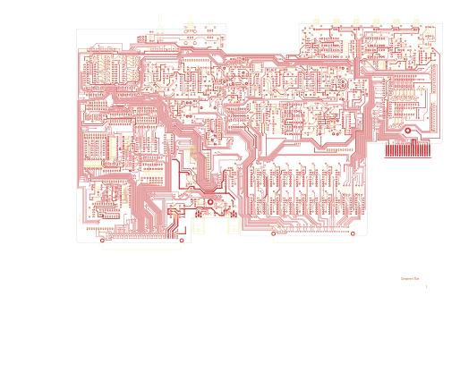

# NEW325

Converted to KiCad from `WBSps Engineering from H drive/WBSps - SA14-XXX/SA14-325/TANGO/NEW325.PCB` (tango).

| Components | Pads | Track segments | Vias | Pours |
|---|---|---|---|---|
| 663 | 2754 | 11965 | 597 | 55 |

Nets: none (no matching netlist).

Other copies of the same file:

- `WBSps Engineering from H drive-20261018T013433Z-1-002/WBSps Engineering from H drive/WBSps - SA14-XXX/SA14-325/TANGO/NEW325.PCB`
