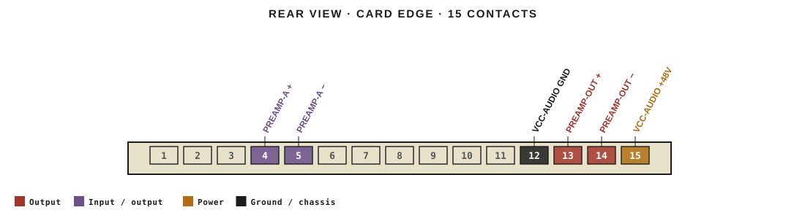
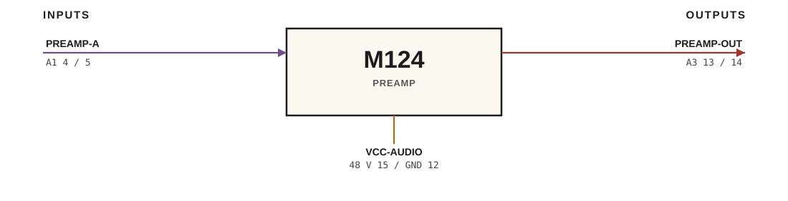

# M124 · RTO-144 Connections

PREAMP

## Audio connections

| Port | Signal | Dir | Pin + | Pin − |
|---|---|---|---|---|
| A1 | PREAMP-A | io | 4 | 5 |
| A3 | PREAMP-OUT | out | 13 | 14 |

## Power

| Rail | Volts | Max A | Supply | Ground |
|---|---|---|---|---|
| VCC-AUDIO | 48 | 0.1 | 15 | 12 |

_Source: Module RTO-144 Jumper calculator.xlsx (Database tab). Verify against the module schematic before wiring._
