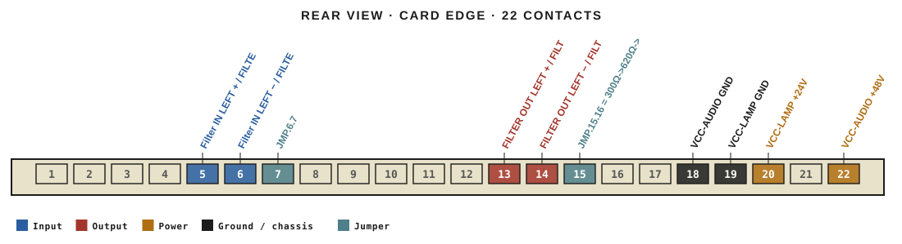
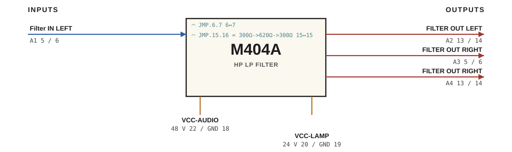

# M404A · RTO-144 Connections

HP LP FILTER

## Audio connections

| Port | Signal | Dir | Pin + | Pin − |
|---|---|---|---|---|
| A1 | Filter IN LEFT | in | 5 | 6 |
| A2 | FILTER OUT LEFT | out | 13 | 14 |
| A3 | FILTER OUT RIGHT | out | 5 | 6 |
| A4 | FILTER OUT RIGHT | out | 13 | 14 |

## Power

| Rail | Volts | Max A | Supply | Ground |
|---|---|---|---|---|
| VCC-AUDIO | 48 | 0.1 | 22 | 18 |
| VCC-LAMP | 24 | 0.1 | 20 | 19 |

## Jumpers

| Function | Designation | From | To |
|---|---|---|---|
| 600Ω Input | JMP.6.7 | 6 | 7 |
| OUtput 2 | JMP.15.16 = 300Ω->620Ω->300Ω | 15 | 15 |

_Source: Module RTO-144 Jumper calculator.xlsx (Database tab). Verify against the module schematic before wiring._
