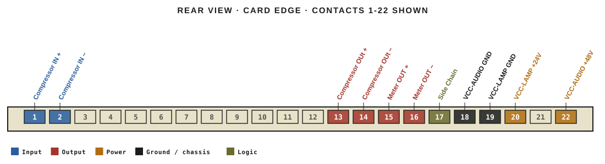
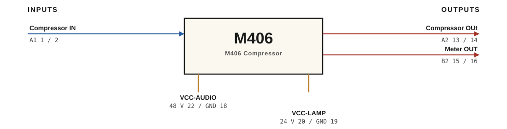

# M406 · RTO-144 Connections

M406 Compressor

## Audio connections

| Port | Signal | Dir | Pin + | Pin − |
|---|---|---|---|---|
| A1 | Compressor IN | in | 1 | 2 |
| A2 | Compressor OUt | out | 13 | 14 |
| B2 | Meter OUT | out | 15 | 16 |

## Power

| Rail | Volts | Max A | Supply | Ground |
|---|---|---|---|---|
| VCC-AUDIO | 48 | 0.1 | 22 | 18 |
| VCC-LAMP | 24 | 0.1 | 20 | 19 |

_Source: Module RTO-144 Jumper calculator.xlsx (Database tab). Verify against the module schematic before wiring._
