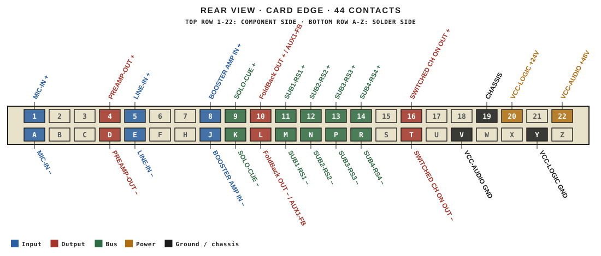
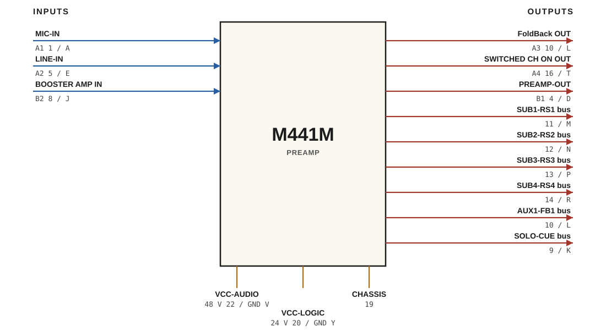

# M441M · RTO-144 Connections

PREAMP

## Audio connections

| Port | Signal | Dir | Pin + | Pin − |
|---|---|---|---|---|
| A1 | MIC-IN | in | 1 | A |
| A2 | LINE-IN | in | 5 | E |
| A3 | FoldBack OUT | out | 10 | L |
| A4 | SWITCHED CH ON OUT | out | 16 | T |
| B1 | PREAMP-OUT | out | 4 | D |
| B2 | BOOSTER AMP IN | in | 8 | J |

## Bus connections

| Bus | Dir | Pin + | Pin − |
|---|---|---|---|
| SUB1-RS1 | out | 11 | M |
| SUB2-RS2 | out | 12 | N |
| SUB3-RS3 | out | 13 | P |
| SUB4-RS4 | out | 14 | R |
| AUX1-FB1 | out | 10 | L |
| SOLO-CUE | out | 9 | K |

## Power

| Rail | Volts | Max A | Supply | Ground |
|---|---|---|---|---|
| VCC-AUDIO | 48 | 0.1 | 22 | V |
| VCC-LOGIC | 24 | 0.1 | 20 | Y |

_Source: Module RTO-144 Jumper calculator.xlsx (Database tab). Verify against the module schematic before wiring._
