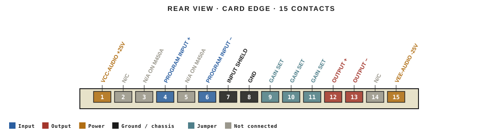
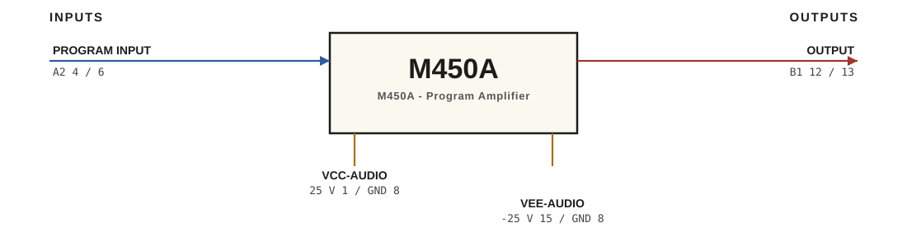

# M450A · RTO-144 Connections

M450A - Program Amplifier · ELCO 00-6007-015-940-002 · 15 contacts, single row

## Audio connections

| Port | Signal | Dir | Pin + | Pin − |
|---|---|---|---|---|
| A2 | PROGRAM INPUT | in | 4 | 6 |
| B1 | OUTPUT | out | 12 | 13 |

## Power

| Rail | Volts | Max A | Supply | Ground |
|---|---|---|---|---|
| VCC-AUDIO | 25 |  | 1 | 8 |
| VEE-AUDIO | -25 |  | 15 | 8 |

## Other pins

| Signal | Pins |
|---|---|
| INPUT SHIELD | 7 |
| COMMON | 8 |
| GAIN SET | 9, 10, 11 |
| N/C | 2, 14 |
| N/A ON M450A | 3, 5 |

_Source: Ward-Beck drawing 450-04-001 iss. 2 (June 1976), M450 and M450A connector layout ("summing amp input N/A for M450A"). Verify against the module before wiring._
