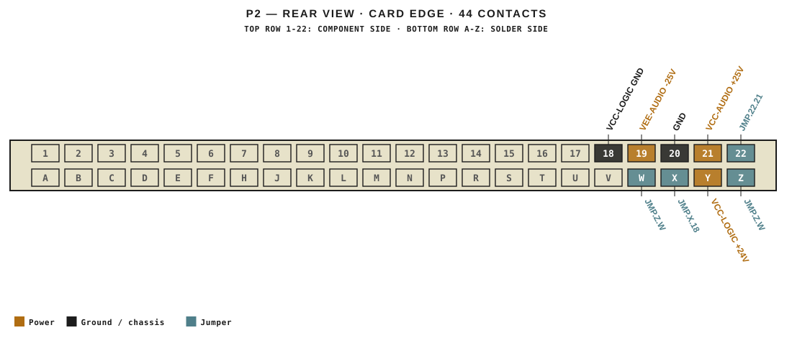

# M453 · RTO-144 Connections

## Power

| Rail | Volts | Max A | Supply | Ground |
|---|---|---|---|---|
| VEE-AUDIO | -25 | 0.1 | P2-19 | P2-20 |
| VCC-AUDIO | 25 | 0.2 | P2-21 | P2-20 |
| VCC-LOGIC | 24 | 0.1 | P2-Y | P2-18 |

## Jumpers

| Function | Designation | From | To |
|---|---|---|---|
| CH ON LAMP | JMP.Z.W | P2-Z | P2-W |
| CH ON GND  | JMP.X.18 | P2-X | P2-18 |
| 24V Jumper | JMP.Y.21 | P2-Y | P2-21 |
| CH ON GND  | JMP.20.18 | P2-20 | P2-18 |
| Insert + | JMP.22.21 | P2-22 | P2-21 |
| Insert - | JMP.Z.Y | P2-Z | P2-Y |
| Fader + | JMP.20.19 | P2-20 | P2-19 |
| Fader -  | JMP.X.W | P2-X | P2-W |

_Source: Module RTO-144 Jumper calculator.xlsx (Database tab). Verify against the module schematic before wiring._
