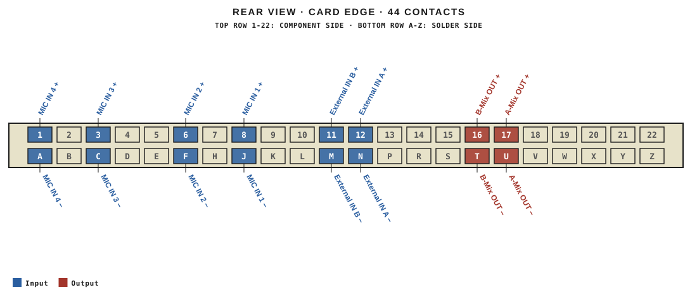
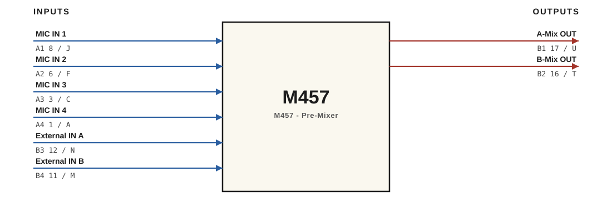

# M457 · RTO-144 Connections

M457 - Pre-Mixer

## Audio connections

| Port | Signal | Dir | Pin + | Pin − |
|---|---|---|---|---|
| A1 | MIC IN 1 | in | 8 | J |
| A2 | MIC IN 2 | in | 6 | F |
| A3 | MIC IN 3 | in | 3 | C |
| A4 | MIC IN 4 | in | 1 | A |
| B1 | A-Mix OUT | out | 17 | U |
| B2 | B-Mix OUT | out | 16 | T |
| B3 | External IN A | in | 12 | N |
| B4 | External IN B | in | 11 | M |

_Source: Module RTO-144 Jumper calculator.xlsx (Database tab). Verify against the module schematic before wiring._
