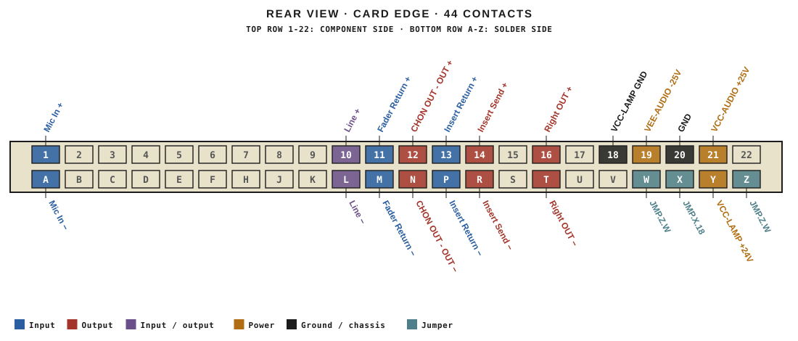
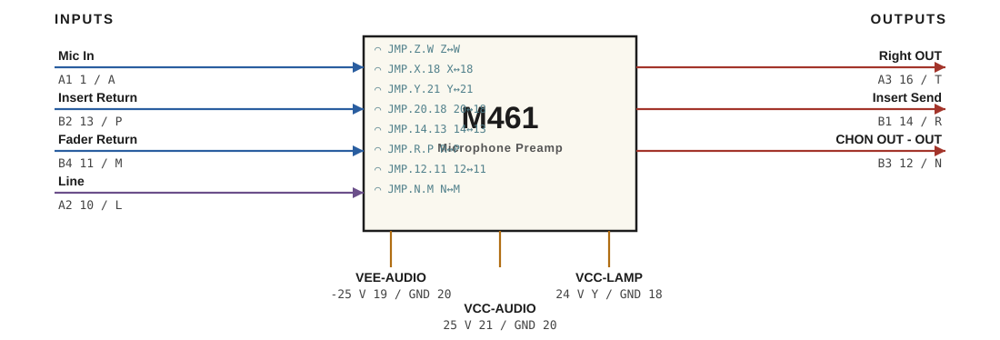

# M461 · RTO-144 Connections

Microphone Preamp

## Audio connections

| Port | Signal | Dir | Pin + | Pin − |
|---|---|---|---|---|
| A1 | Mic In | in | 1 | A |
| A2 | Line | io | 10 | L |
| A3 | Right OUT | out | 16 | T |
| B1 | Insert Send | out | 14 | R |
| B2 | Insert Return | in | 13 | P |
| B3 | CHON OUT - OUT | out | 12 | N |
| B4 | Fader Return | in | 11 | M |

## Power

| Rail | Volts | Max A | Supply | Ground |
|---|---|---|---|---|
| VEE-AUDIO | -25 | 0.1 | 19 | 20 |
| VCC-AUDIO | 25 | 0.2 | 21 | 20 |
| VCC-LAMP | 24 | 0.1 | Y | 18 |

## Jumpers

| Function | Designation | From | To |
|---|---|---|---|
| CH ON LAMP | JMP.Z.W | Z | W |
| 24V Ground | JMP.X.18 | X | 18 |
| 24V to 25V | JMP.Y.21 | Y | 21 |
| CH ON GND  | JMP.20.18 | 20 | 18 |
| Insert  SEND | JMP.14.13 | 14 | 13 |
| Insert  Return | JMP.R.P | R | P |
| Fader Send | JMP.12.11 | 12 | 11 |
| Fader Return | JMP.N.M | N | M |

_Source: Module RTO-144 Jumper calculator.xlsx (Database tab). Verify against the module schematic before wiring._
