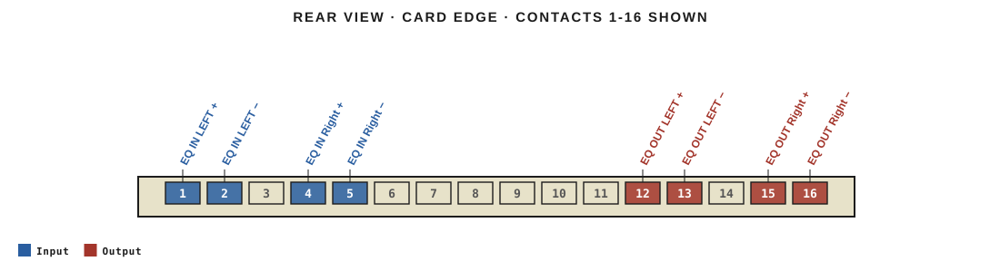
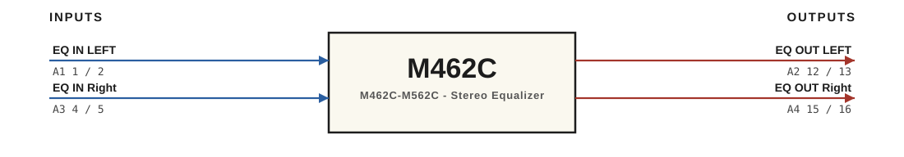

# M462C · RTO-144 Connections

M462C-M562C - Stereo Equalizer

## Audio connections

| Port | Signal | Dir | Pin + | Pin − |
|---|---|---|---|---|
| A1 | EQ IN LEFT | in | 1 | 2 |
| A2 | EQ OUT LEFT | out | 12 | 13 |
| A3 | EQ IN Right | in | 4 | 5 |
| A4 | EQ OUT Right | out | 15 | 16 |

_Source: Module RTO-144 Jumper calculator.xlsx (Database tab). Verify against the module schematic before wiring._
