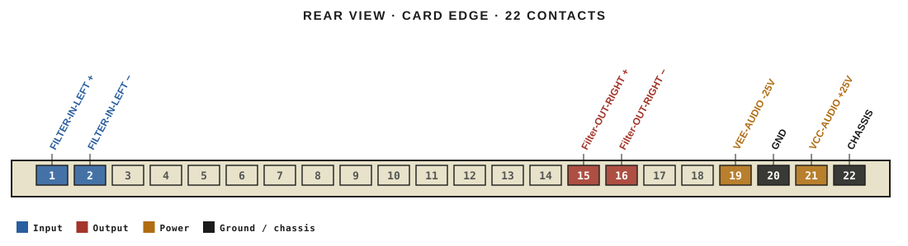
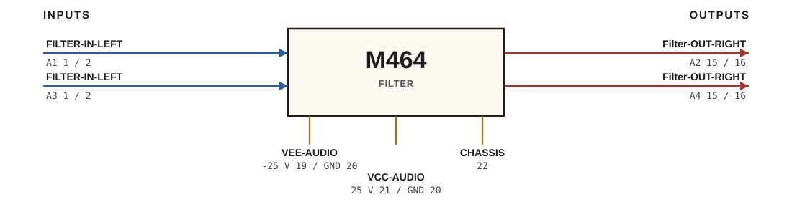

# M464 · RTO-144 Connections

FILTER

## Audio connections

| Port | Signal | Dir | Pin + | Pin − |
|---|---|---|---|---|
| A1 | FILTER-IN-LEFT | in | 1 | 2 |
| A2 | Filter-OUT-RIGHT | out | 15 | 16 |
| A3 | FILTER-IN-LEFT | in | 1 | 2 |
| A4 | Filter-OUT-RIGHT | out | 15 | 16 |

## Power

| Rail | Volts | Max A | Supply | Ground |
|---|---|---|---|---|
| VEE-AUDIO | -25 | 0.2 | 19 | 20 |
| VCC-AUDIO | 25 | 0.2 | 21 | 20 |

_Source: Module RTO-144 Jumper calculator.xlsx (Database tab). Verify against the module schematic before wiring._
