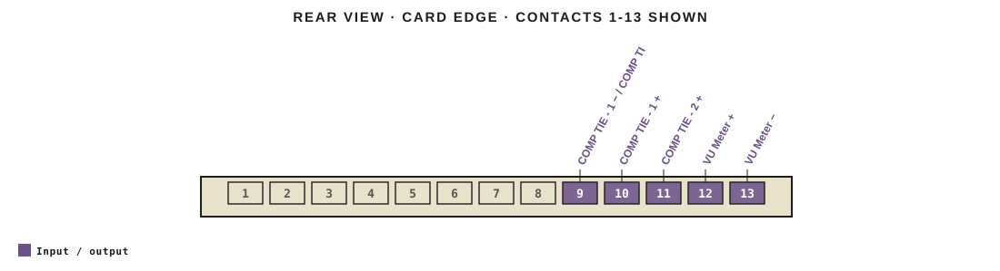
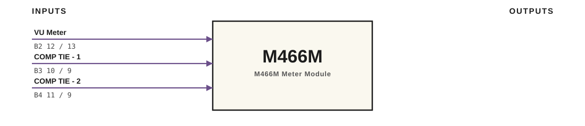

# M466M · RTO-144 Connections

M466M Meter Module

## Audio connections

| Port | Signal | Dir | Pin + | Pin − |
|---|---|---|---|---|
| B2 | VU Meter | io | 12 | 13 |
| B3 | COMP TIE - 1 | io | 10 | 9 |
| B4 | COMP TIE - 2 | io | 11 | 9 |

_Source: Module RTO-144 Jumper calculator.xlsx (Database tab). Verify against the module schematic before wiring._
