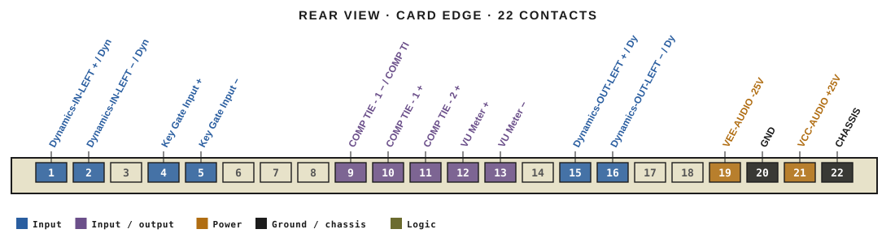
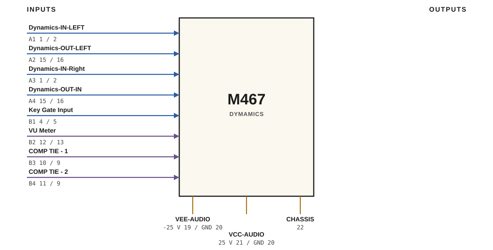

# M467 · RTO-144 Connections

DYMAMICS

## Audio connections

| Port | Signal | Dir | Pin + | Pin − |
|---|---|---|---|---|
| A1 | Dynamics-IN-LEFT | in | 1 | 2 |
| A2 | Dynamics-OUT-LEFT | in | 15 | 16 |
| A3 | Dynamics-IN-Right | in | 1 | 2 |
| A4 | Dynamics-OUT-IN | in | 15 | 16 |
| B1 | Key Gate Input | in | 4 | 5 |
| B2 | VU Meter | io | 12 | 13 |
| B3 | COMP TIE - 1 | io | 10 | 9 |
| B4 | COMP TIE - 2 | io | 11 | 9 |

## Power

| Rail | Volts | Max A | Supply | Ground |
|---|---|---|---|---|
| VEE-AUDIO | -25 | 0.2 | 19 | 20 |
| VCC-AUDIO | 25 | 0.2 | 21 | 20 |

_Source: Module RTO-144 Jumper calculator.xlsx (Database tab). Verify against the module schematic before wiring._
