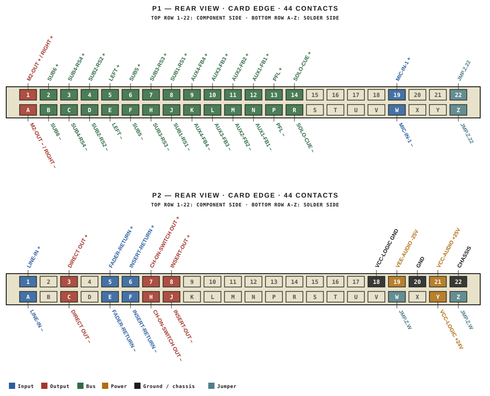
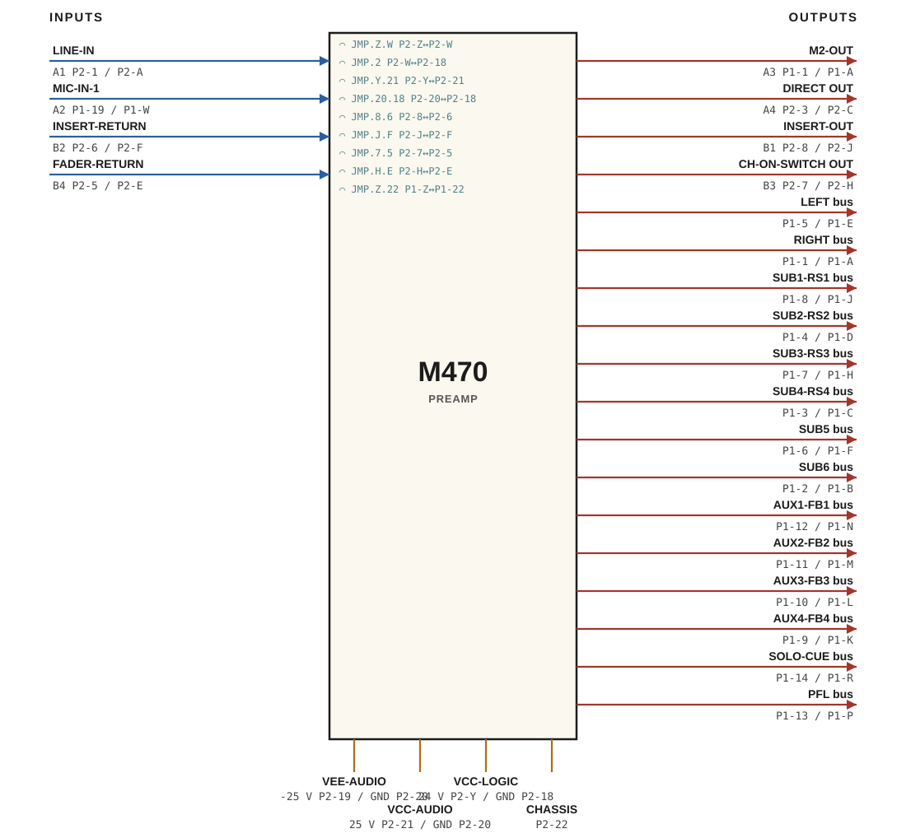

# M470 · RTO-144 Connections

PREAMP

## Audio connections

| Port | Signal | Dir | Pin + | Pin − |
|---|---|---|---|---|
| A1 | LINE-IN | in | P2-1 | P2-A |
| A2 | MIC-IN-1 | in | P1-19 | P1-W |
| A3 | M2-OUT | out | P1-1 | P1-A |
| A4 | DIRECT OUT | out | P2-3 | P2-C |
| B1 | INSERT-OUT | out | P2-8 | P2-J |
| B2 | INSERT-RETURN | in | P2-6 | P2-F |
| B3 | CH-ON-SWITCH OUT | out | P2-7 | P2-H |
| B4 | FADER-RETURN | in | P2-5 | P2-E |

## Bus connections

| Bus | Dir | Pin + | Pin − |
|---|---|---|---|
| LEFT | out | P1-5 | P1-E |
| RIGHT | out | P1-1 | P1-A |
| SUB1-RS1 | out | P1-8 | P1-J |
| SUB2-RS2 | out | P1-4 | P1-D |
| SUB3-RS3 | out | P1-7 | P1-H |
| SUB4-RS4 | out | P1-3 | P1-C |
| SUB5 | out | P1-6 | P1-F |
| SUB6 | out | P1-2 | P1-B |
| AUX1-FB1 | out | P1-12 | P1-N |
| AUX2-FB2 | out | P1-11 | P1-M |
| AUX3-FB3 | out | P1-10 | P1-L |
| AUX4-FB4 | out | P1-9 | P1-K |
| SOLO-CUE | out | P1-14 | P1-R |
| PFL | out | P1-13 | P1-P |

## Power

| Rail | Volts | Max A | Supply | Ground |
|---|---|---|---|---|
| VEE-AUDIO | -25 | 0.2 | P2-19 | P2-20 |
| VCC-AUDIO | 25 | 0.2 | P2-21 | P2-20 |
| VCC-LOGIC | 24 | 0.2 | P2-Y | P2-18 |

## Jumpers

| Function | Designation | From | To |
|---|---|---|---|
| CH ON LAMP | JMP.Z.W | P2-Z | P2-W |
| CH ON GND  | JMP.2 | P2-W | P2-18 |
| 24V Jumper | JMP.Y.21 | P2-Y | P2-21 |
| CH ON GND  | JMP.20.18 | P2-20 | P2-18 |
| Insert + | JMP.8.6 | P2-8 | P2-6 |
| Insert - | JMP.J.F | P2-J | P2-F |
| Fader + | JMP.7.5 | P2-7 | P2-5 |
| Fader -  | JMP.H.E | P2-H | P2-E |
| EQ BYPASS | JMP.Z.22 | P1-Z | P1-22 |

_Source: Module RTO-144 Jumper calculator.xlsx (Database tab). Verify against the module schematic before wiring._
